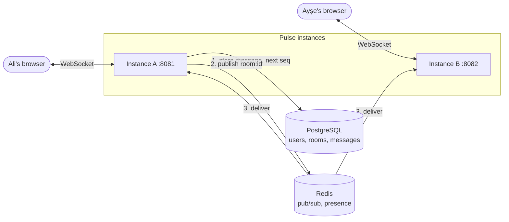

# Pulse

Pulse is a real-time chat backend written in Java with Spring Boot, PostgreSQL and Redis. I built it to cover what a chat server has to get right: delivering a message to everyone in a room within milliseconds, never losing one when a phone drops off the network and comes back, keeping several server instances in step, and protecting the servers from clients that are too slow, silent or noisy.

[](https://github.com/hmzckd/pulse/actions/workflows/ci.yml)

## What it includes

- Plain WebSocket at `/ws` with a small JSON protocol, authenticated with a short-lived JWT during the handshake
- Public rooms that users create and join, with every message stored in PostgreSQL before it is delivered
- A gapless sequence number per room, so a client always knows whether it missed something
- Acknowledgements and client message ids, so sending the same message again after a lost connection never stores it twice
- Catch-up after reconnecting: the client sends the last number it saw per room and gets what it missed
- Message history with keyset pagination, typing indicators and online presence
- Unread counts computed from two numbers instead of counting rows
- Two or more server instances kept in step through Redis pub/sub, with presence stored in Redis
- Protection against slow consumers (close code `4008`), dead connections (ping every 25 seconds) and spam (20 messages per 10 seconds per connection)
- Prometheus metrics, a k6 load test with 5,000 connections, and a small demo page
- Tests against real PostgreSQL and Redis with Testcontainers, including two application instances in one test

## How it fits together



The instance that receives a message stores it in PostgreSQL inside a transaction that also takes the room's next sequence number, sends an acknowledgement to the sender, and publishes the message on the room's Redis channel. Every instance with a connection in that room, including the one that stored it, delivers it from Redis to its own connections. Redis pub/sub may drop a message; the database never does, and the client notices the gap in sequence numbers and asks for the missing messages. No sticky sessions are needed, because every instance can serve every user.

## Stack

| Area | Technology |
| --- | --- |
| Service | Java 21, Spring Boot 4.1 (Web MVC, WebSocket, Security, Actuator), virtual threads |
| Database | PostgreSQL 17, Spring JDBC (`JdbcClient`), Flyway migrations |
| Between instances | Redis 8 pub/sub and sorted sets |
| Authentication | JWT (HS256) as an OAuth2 resource server |
| Metrics | Micrometer, Prometheus format |
| Tests | JUnit 5, Testcontainers, Awaitility, k6 for load |
| Container | Multi-stage Dockerfile, JRE image, non-root user |
| CI | GitHub Actions |

## Repository layout

```text
.
├── src/main/java/com/hmzckd/pulse/
│   ├── auth/             login, JWT, security rules
│   ├── room/             rooms, members, read markers
│   ├── message/          storing messages, sequence numbers, history, sync
│   ├── chat/             WebSocket handler, connections, Redis relay, presence, heartbeat, metrics
│   └── web/              errors as problem+json
├── src/main/resources/
│   ├── db/migration/     Flyway migrations
│   └── static/           demo page (HTML, CSS, JavaScript)
├── src/test/java/        integration tests, including two instances sharing PostgreSQL and Redis
├── load-test/chat.js     k6 load test
├── docs/adr/             architecture decision records
├── docs/load-test.md     load test scenario and results
├── GLOSSARY.md           domain terms
├── Dockerfile
├── compose.yaml          PostgreSQL, Redis and two Pulse instances
└── .github/workflows/ci.yml
```

## Run locally

### Requirements

- Docker Desktop
- JDK 21 or newer, to run the tests or the service without Docker

### 1. Start everything

```powershell
docker compose up -d --build
```

Instance A listens on `http://localhost:8081`, instance B on `http://localhost:8082`, PostgreSQL on `localhost:5437` and Redis on `localhost:6380`. The compose file sets a development JWT secret; never use it outside your machine.

### 2. Chat across two servers

1. Open `http://localhost:8081`, join as `ali` and create a room called `General`.
2. In a second window open `http://localhost:8082`, join as `ayse` and press **Join** next to `General`.
3. Each page shows which server it is connected to. Write in one window: the other shows "ali is typing…" and then the message.

### 3. Restart a server

```powershell
docker compose stop pulse-b
```

Ayşe's page shows that it is retrying. Send two messages as Ali, then:

```powershell
docker compose start pulse-b
```

Ayşe's page reconnects by itself, waiting 1, 2, 4... up to 30 seconds between attempts, and the two messages appear.

### Run the service with Maven instead

```powershell
docker compose up -d postgres redis
$env:PULSE_JWT_SECRET = "dev-secret-dev-secret-dev-secret-123"
.\mvnw.cmd spring-boot:run
```

| Variable | Default | Meaning |
| --- | --- | --- |
| `PULSE_JWT_SECRET` | required | Key that signs session tokens, at least 32 bytes |
| `PORT` | `8080` | HTTP and WebSocket port |
| `PULSE_INSTANCE_ID` | random | Name of this instance, shown to clients and used for presence |
| `SPRING_DATASOURCE_URL` | `jdbc:postgresql://localhost:5437/pulse` | PostgreSQL |
| `SPRING_DATA_REDIS_HOST`, `SPRING_DATA_REDIS_PORT` | `localhost`, `6380` | Redis |

## Checks

Docker must be running, because the tests start their own PostgreSQL and Redis containers:

```powershell
.\mvnw.cmd test
```

## WebSocket protocol

Connect to `ws://<host>/ws?token=<session token>`. A wrong token is rejected with `401` and a page from another site with `403`. Every frame is a JSON object with a `type`.

| Direction | Type | Purpose |
| --- | --- | --- |
| server → client | `ready` | Connected: username, server name, room ids, who is online. Live delivery is already on. |
| client → server | `message.send` | `roomId`, `clientMsgId` (UUID), `text` (1-2000 characters) |
| server → client | `message.ack` | Stored: `clientMsgId`, `id`, `seq`, `sentAt`. Sent only to the sender. |
| server → client | `message.new` | A message in one of the user's rooms, with its `seq` |
| client → server | `sync` | `rooms`: last seen `seq` per room |
| server → client | `sync.messages` | Up to 500 missed messages per room, `truncated` when there are more |
| client → server | `typing` | The user is writing in a room; at most one is forwarded every 2 seconds |
| server → client | `typing` | Someone else is writing in a room |
| server → client | `presence` | A user who shares a room came online or went offline |
| client → server | `read` | `roomId` and `seq` the user has read |
| server → client | `read` | The user's read marker moved (sent to all of the user's tabs) |
| server → client | `error` | `invalid_json`, `unknown_type`, `invalid_message`, `invalid_sync`, `not_a_member`, `rate_limited` or `save_failed`; the connection stays open |

The server closes a connection with `4008` when the client cannot keep up and with `4000` when it stops answering pings. Clients reconnect and send `sync`.

## REST API

All routes except login need `Authorization: Bearer <session token>`.

| Method | Route | Purpose |
| --- | --- | --- |
| POST | `/api/sessions` | Log in with a username (created on first use), returns a token valid for one hour |
| POST | `/api/rooms` | Create a room and join it |
| GET | `/api/rooms` | List rooms |
| GET | `/api/rooms/mine` | The user's rooms with `lastSeq`, `lastReadSeq` and `unread` |
| GET | `/api/rooms/{id}` | Get a room |
| POST | `/api/rooms/{id}/members` | Join a room |
| GET | `/api/rooms/{id}/messages?before=&limit=` | Message history, newest page first, `nextBefore` for the previous page |
| GET | `/actuator/health` | Health, including PostgreSQL and Redis |
| GET | `/actuator/prometheus` | Metrics, including `pulse_connections_open` and `pulse_messages_sent_total` |

Errors are returned as `application/problem+json`: 400 for invalid input, 401 for a missing or invalid token, 403 for a room the user has not joined, and 404 for an unknown room. In a real deployment `/actuator/prometheus` would only be reachable from inside the network.

## Load test

5,000 WebSocket connections in 100 rooms, split between two instances, each user sending a message every 20 seconds. Delivery time is measured from the moment the sender sent the message to the moment another member received it.

| Metric | Result |
| --- | --- |
| Connections opened | 100% |
| Messages delivered | 1,745,866 (about 9,500 a second) |
| Delivery time p50 / p95 | 7 ms / 135 ms |

Both instances, PostgreSQL, Redis and k6 ran on one machine with 4 vCPUs. Scenario, how to run it and the full results: [`docs/load-test.md`](docs/load-test.md).

## Design decisions

| ADR | Decision |
| --- | --- |
| [0001](docs/adr/0001-plain-websocket-with-own-json-protocol.md) | Plain WebSocket with our own JSON protocol, not STOMP |
| [0002](docs/adr/0002-gapless-sequence-number-per-room.md) | A gapless sequence number per room, taken under a row lock |
| [0003](docs/adr/0003-redis-pub-sub-as-best-effort-relay.md) | Redis pub/sub as a best-effort relay; the database is the source of truth |
| [0004](docs/adr/0004-close-slow-and-silent-connections.md) | Close slow and silent connections, limit messages per connection |

Terms such as sequence number, sync and presence are defined in [`GLOSSARY.md`](GLOSSARY.md).

## Not included

Passwords, private rooms and direct messages, editing and deleting messages, read receipts for other users, file uploads and push notifications. The rate limit is per connection and in memory; a shared limiter in Redis would make it hold across instances.
